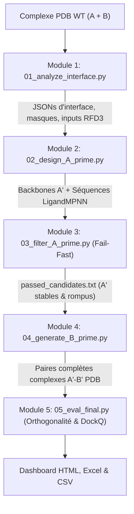

# OrthoPPInterface : Architecture Complète, Diagnostic Expérimental et Verrous Méthodologiques

Ce document offre une synthèse technique exhaustive du projet **OrthoPPInterface**, de ses modules, de son flux de données, et des blocages physiques et algorithmiques observés lors des dernières campagnes de calculs (notamment sous **RoseTTAFold-3 All-Atom**). Il est structuré pour permettre une analyse critique et la formulation de correctifs architecturaux (par exemple sous Claude ou en revue de code pair).

---

## 1. Objectif Scientifique & Métriques d'Orthogonalité

L'objectif d'**OrthoPPInterface** est de concevoir rationnellement un couple de protéines artificiellement orthogonal ($A' - B'$) à partir d'un complexe naturel de départ ($A_{WT} - B_{WT}$) :
1. **Rupture ($A' \times B_{WT}$)** : La protéine $A'$ mutée ne doit plus se lier à son partenaire sauvage $B_{WT}$ ($\text{iPTM} < 0.35$).
2. **Sauvetage / Reconnaissance croisée ($A' - B'$)** : La protéine $B'$ est redessinée pour restaurer l'affinité avec $A'$ ($\text{iPTM} > 0.75$).
3. **Orthogonalité négative ($A_{WT} \times B'$)** : $B'$ ne doit pas interagir avec le partenaire sauvage $A_{WT}$ ($\text{iPTM} < 0.35$).
4. **Métrique globale d'orthogonalité ($F_{ortho}$)** :
   $$F_{ortho} = \text{iPTM}_{rescue}(A' - B') - \max\big(\text{iPTM}_{rupture}(A' - B_{WT}),\; \text{iPTM}_{negative}(A_{WT} - B')\big)$$
   Un design réussi doit avoir $F_{ortho} > 0.30$ avec une géométrie d'interface conforme à la cible (évaluée via le score DockQ / CAPRI).

---

## 2. Architecture Modulaire & Flux de Données

Le pipeline est orchestré par `run_pipeline.py` et s'articule en 5 modules séquentiels :



### Module 1 : Analyse d'Interface & Contraintes (`src/01_analyze_interface.py`)
- **Détection géométrique** : Calcule les distances inter-atomes lourds entre les chaînes A et B.
  - Résidus d'interface : distance $< 6.0$ Å.
  - Voisinage structurel (neighborhood) : distance $< 10.0$ Å.
- **Sélection des hotspots** : Trie les résidus de A ayant le plus de contacts inter-chaînes.
- **Masquage LigandMPNN** : Fixe les résidus internes du cœur hydrophobe et n'autorise les mutations que sur la couronne d'interface (`mpnn_fixed_positions_B.json`).
- **Génération des manifestes RFD3** :
  - `inputs_rupture.json` : Définit la zone de diffusion pour A (partielle ou de novo sur l'interface).
  - `inputs_rescue.json` : Définit la zone de diffusion pour B autour de A'.

### Module 2 : Rupture Design de A' (`src/02_design_A_prime.py`)
- **Diffusion RFD3** : Génère $N$ squelettes de A altérés au niveau de l'interface pour éliminer la complémentarité de forme avec $B_{WT}$.
- **Séquençage LigandMPNN** : Conçoit des séquences sur les nouveaux squelettes avec une température basse ($T = 0.2$) pour garantir la stabilité du monomère.

### Module 3 : Filtrage Fail-Fast (`src/03_filter_A_prime.py`)
- **Stabilité Monomère $A'$** : Évalue le repliement de $A'$ seul via RoseTTAFold-3 (pLDDT $> 80$, RMSD C-alpha $< 2.0$ Å).
- **Contrôle de Rupture** : Co-replie $A' + B_{WT}$ dans RF3 et vérifie que $\text{iPTM} < 0.35$.
- Enregistre les motifs $A'$ validés dans `passed_candidates.txt`.

### Module 4 : Sauvetage B' Multi-Scaffolds (`src/04_generate_B_prime.py`)
- **Sélection Diversifiée des $A'$** : Algorithme *Farthest-Point Clustering* sur la séquence d'interface pour retenir des motifs $A'$ distincts (ex. 8 motifs).
- **Superposition** : Aligne $A'$ sur le repère de coordonnées WT.
- **Co-adaptation RFD3 de la chaîne B** :
  - Exécute RFdiffusion sur B en présence de $A'$ fixe pour adapter le squelette de B à la nouvelle surface de $A'$.
  - Sélectionne jusqu'à `max_rescue_scaffolds` (ex. 4 squelettes).
- **Séquençage LigandMPNN par Squelette** :
  - Échantillonne des dizaines de séquences pour chaque squelette de B.
  - Sélectionne les $K$ meilleures solutions diversifiées.
- **Génération des complexes finaux** : Assemble les chaînes A' et B' complètes dans des fichiers PDB unifiés.

### Module 5 : Matrice Finale d'Orthogonalité (`src/05_eval_final.py`)
- Utilise **RoseTTAFold-3 All-Atom (RF3)** pour évaluer :
  1. **Positif** : $A' + B'$ ($\rightarrow \text{iPTM}_{rescue}$).
  2. **Négatif** : $A_{WT} + B'$ ($\rightarrow \text{iPTM}_{negative}$).
  3. **Rupture** : $A' + B_{WT}$ ($\rightarrow \text{iPTM}_{rupture}$, récupéré de l'Étape 3).
- **Alignement DockQ** : Mesure la qualité native du complexe prédit par rapport au cristal WT (Fnat, Irms, Lrms, classification CAPRI *Incorrect / Acceptable / Medium / High*).
- **Reporting** : Exporte les tables, base SQLite (`results.db`), Excel stylé et Dashboard interactif HTML.

---

## 3. Le Moteur de Repliement : Transition vers RoseTTAFold-3 (`src/folding_engine.py`)

Initialement conçu avec ColabFold (AlphaFold2-Multimer), le moteur a été migré vers **RoseTTAFold-3 All-Atom (Foundry RF3)** exécuté localement sous environnement WSL GPU (RTX 5070 Ti).

### Avantages de RF3 :
- **Vitesse d'inférence** : ~1 minute par complexe sur GPU contre 4 à 8 minutes sous AF2 avec recyclages.
- **Richesse des métriques physiques** :
  - $\text{pLDDT}$ global et par chaîne.
  - $\text{pTM}$ par chaîne individuelle (ex: `chain_ptm: [0.80, 0.75]`).
  - $\text{iPTM}$ d'interface.
  - $\text{PAE}$ (Predicted Aligned Error) et $\text{PDE}$ (Predicted Distance Error, métrique continue).
  - Détection automatique de clashs stériques (`has_clash`).

### Pont d'Appel Technique :
- Le script génère un manifeste JSON RF3 :
  ```json
  [
    {
      "name": "cand_pair",
      "components": [
        {"seq": "...", "chain_id": "A", "msa_path": "/mnt/c/.../A.a3m"},
        {"seq": "...", "chain_id": "B", "msa_path": "/mnt/c/.../B.a3m"}
      ]
    }
  ]
  ```
- Exécution CLI via `wsl -d Ubuntu -- rf3 fold inputs=... out_dir=... ckpt_path=...`.
- Conversion automatique du modèle `.cif` de sortie en PDB standard via BioPython.

---

## 4. Les Résultats Expérimentaux Actuels (Run `run_rf3_optimized`)

| design_id | iptm_rescue ($A'-B'$) | iptm_rupture ($A'-B_{WT}$) | iptm_negative ($A_{WT}-B'$) | $F_{ortho}$ | DockQ | RMSD $B'$ vs WT |
| :--- | :---: | :---: | :---: | :---: | :---: | :---: |
| **A_cand_01_B_00** | 0.283 | 0.295 | 0.238 | **-0.011** | 0.345 (Acc) | $8.18 \times 10^{-15}$ Å |
| **A_cand_01_B_01** | 0.260 | 0.295 | 0.235 | **-0.034** | 0.401 (Acc) | $8.18 \times 10^{-15}$ Å |
| **A_cand_11_B_01** | 0.269 | 0.259 | 0.356 | **-0.087** | 0.155 (Inc) | $8.18 \times 10^{-15}$ Å |
| **A_cand_19_B_00** | 0.256 | 0.227 | 0.550 | **-0.294** | 0.116 (Inc) | $8.18 \times 10^{-15}$ Å |
| **A_cand_13_B_01** | 0.232 | 0.246 | 0.649 | **-0.417** | 0.187 (Inc) | $8.18 \times 10^{-15}$ Å |

Tous les scores $F_{ortho}$ sont négatifs.

---

## 5. Diagnostic des 3 Problématiques Majeures Rencontrées

### Problématique 1 : Le Verrou de la MSA dans RoseTTAFold-3 (Score iPTM bridé à ~0.25)
**Le test de contrôle fondamental que nous avons réalisé met en lumière ce mécanisme :**
1. **$A_{WT} + B_{WT}$ avec MSA complète** : $\text{iPTM} = \mathbf{0.867}$ | $\text{pLDDT} = 84\%$
2. **$A_{WT} + B_{WT}$ sans MSA (séquence seule)** : $\text{iPTM} = \mathbf{0.204}$ | $\text{pLDDT} = 71\%$
3. **Candidats conçus avec MSA hybride masquée** : $\text{iPTM} = \mathbf{0.203 - 0.283}$

**Mécanisme en cause :**
Dans `folding_engine.py`, la fonction `build_hybrid_msa()` prend l'alignement sauvage (.a3m) et remplace **toutes les colonnes des positions mutées par des gaps (`-`)** pour éviter que l'information sauvage ne pollue le mutant.
Or, comme l'interface comporte 25 à 30 mutations sur A et 25 à 30 mutations sur B, **100% du signal de co-évolution inter-chaînes est effacé**. 
Contrairement aux monomères qui peuvent se replier grâce aux matrices de distance internes conservées (`chain_ptm ~ 0.75-0.80`), **RoseTTAFold-3 dépend très fortement de la co-évolution pour prédire l'orientation et l'affinité inter-chaînes**. En l'absence de co-évolution, il applique son a priori de fond et prédit une non-liaison systématique ($\text{iPTM} \approx 0.25$).

### Problématique 2 : L'Échec de la Déformation du Squelette de B' (RMSD B' = 0 Å)
Voici exactement pourquoi dans `run_rf3_optimized`, le squelette est resté à 0 Å de déformation :
1. Dans `src/04_generate_B_prime.py` (l. 257) :
   ```python
   scaffolds_to_process = [complex_pdb] # <-- Scaffold 0 = Backbone NATIF WT de B
   for p in rfd_pdbs:
       scaffolds_to_process.append(p)  # <-- Scaffolds 1, 2, 3 = Squelettes diffusés par RFD3
   ```
2. LigandMPNN séquence ensuite chaque squelette et empile les résultats dans une liste globale :
   ```python
   # Les 15 premiers candidats de la liste proviennent de Scaffold 0 !
   motif_all_mpnn_outputs.extend(mpnn_outputs)
   ```
3. L'algorithme de sélection finale applique une divergence de séquence pure (*Hamming distance*) pour choisir $K=2$ candidats :
   - Il sélectionne d'office l'index 0 (qui est issu de **Scaffold 0**).
   - Pour trouver la 2ème séquence la plus distante, il regarde dans la liste. Comme les 15 variantes de Scaffold 0 présentent déjà une forte variabilité de séquence entre elles, le 2ème choix est **également pioché dans Scaffold 0** !
4. **Conséquence directe :** Les squelettes réellement générés par RFD3 (Scaffolds 1, 2, ...) n'ont jamais été retenus dans les paires finales. $B'$ a été forcé sur le squelette rigide WT de B, d'où `rmsd_b_prime = 8.18e-15 Å`.

### Problématique 3 : L'Absence de Contrainte de Design Négatif explicite dans LigandMPNN
Dans le tableau de scores, pour `A_prime_candidate_13_B_cand_01`, $\text{iPTM}_{negative} (A_{WT} + B') = \mathbf{0.649}$, alors que $\text{iPTM}_{rescue} (A' + B') = \mathbf{0.232}$.
- **Pourquoi ?** LigandMPNN optimise uniquement la probabilité conditionnelle $P(\text{seq}_{B'} \mid \text{backbone}_{B'}, \text{backbone}_{A'}, \text{seq}_{A'})$.
- Il cherche les acides aminés les plus stables pour cette interface. Si la géométrie globale de l'interface ressemble à la forme canonique, la séquence optimisée par LigandMPNN s'avère souvent être un excellent liant pour la chaîne $A_{WT}$ sauvage !
- Il n'y a actuellement **aucune pénalisation ou filtrage négatif** forçant l'apparition d'encombrements stériques ou d'incompatibilités de charge spécifiques vis-à-vis de $A_{WT}$.

---

## 6. Pistes de Résolution Stratégiques à Discuter

1. **Stratégie MSA pour la validation RF3 / AF2** :
   - Faut-il continuer à masquer agressivement les colonnes mutées avec des gaps dans l'alignement, ou tester :
     a) Des alignements appariés spécifiques (*paired MSAs*) ?
     b) Laisser les séquences homologues sans masquage artificiel (en ne changeant que la query) pour conserver le contexte structurel ?
     c) Utiliser un filtre de validation hybride (ex: un repliement de structure avec RF3 mais une évaluation d'énergie libre de liaison / contact via Rosetta FastRelax ou FoldX, ou un consensus avec AF2-Multimer) ?
2. **Forcer la prise en compte des squelettes RFD3** :
   - Supprimer l'injection de `complex_pdb` (scaffold 0 natif) dans `scaffolds_to_process`, ou imposer qu'au moins 1 candidat retenu provienne strictement de chaque squelette diffusé alternatif par RFD3.
   - Augmenter le bruit de diffusion de RFD3 sur B pour forcer des réarrangements locaux du backbone (par exemple 2 à 4 Å de déplacement local).
3. **Pénalisation Négative dans le Design de B'** :
   - Filtrer les candidats $B'$ immédiatement après LigandMPNN par un calcul rapide de complémentarité contre $A_{WT}$.
   - Forcer des acides aminés "clashants" (ex: volumineux comme Trp/Tyr ou chargés) en face des résidus invariants de $A_{WT}$.
