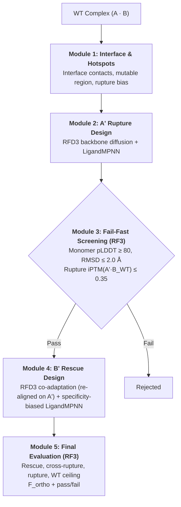

# OrthoPPInterface 🧬🔬

**Automated End-to-End Pipeline for De Novo Orthogonal Protein-Protein Interface Redesign**

OrthoPPInterface is a computational biology framework designed to re-engineer protein-protein interaction (PPI) pairs $(A \cdot B)$ into mutually orthogonal synthetic pairs $(A' \cdot B')$. The designed pair should bind each other while neither component binds the original wild-type counterpart.



---

## 📁 Repository Structure

```text
OrthoPPInterface/
├── pipeline/             # Core computational pipeline
│   ├── src/              # Algorithmic modules (01 to 05, scoring, engines)
│   ├── bin/              # Portable tool execution wrappers (RFD3, LigandMPNN)
│   └── tests/            # Comprehensive unit test suite (pytest)
├── data/                 # Native reference inputs (PDB complex, MSAs)
├── runs/                 # Experiment execution outputs (git-ignored)
├── config.yaml           # Unified pipeline configuration
├── environment.yml       # Unified conda environment definition (Python 3.12)
├── run_pipeline.py       # Master pipeline runner
├── CLAUDE.md             # Project invariants, conventions and commands
└── README.md             # This documentation
```

---

## 📑 Table of Contents
1. [Theoretical Principles](#theoretical-principles)
2. [Pipeline Architecture (Modules 1–5)](#pipeline-architecture-modules-15)
3. [Experiment Management & Isolated Runs](#experiment-management--isolated-runs)
4. [Installation & Environments](#installation--environments)
5. [Quickstart & Usage](#quickstart--usage)
6. [Configuration Reference (`config.yaml`)](#configuration-reference-configyaml)
7. [Output Files & Database Schema](#output-files--database-schema)
8. [Tests](#tests)
9. [Authors & Acknowledgments](#authors--acknowledgments)

---

## 🧮 Theoretical Principles

### 1. The Orthogonality Problem
Given a native complex $A \cdot B$, the objective is to engineer variants $A'$ and $B'$ such that:
1. **Monomer stability**: $A'$ folds into its native conformation ($\text{pLDDT} \ge 80$, global $C_\alpha$ $\text{RMSD} \le 3.0$ Å, and core framework $\text{RMSD} \le 1.5$ Å) — gated in Module 3. $B'$ is judged through the rescue complex (`plddt_rescue`, self-consistency).
2. **Wild-type rupture** $A' \cdot B_{\text{WT}}$: $\text{iPTM} \le 0.45$ (or configured `iptm_rupture_max`).
3. **Cross-wild-type rupture** $A_{\text{WT}} \cdot B'$: $\text{iPTM} \le 0.65$ (or configured `iptm_negative_max`).
4. **Synthetic rescue** $A' \cdot B'$: high $\text{iPTM}$ (default $\ge 0.70$, or $\ge 0.80 \times$ the WT ceiling of the same MSA regime, whichever is lower) AND CAPRI geometric fidelity ($\text{DockQ} \ge 0.23$, $\text{L-RMSD} \le 15.0$ Å).

### 2. Orthogonality Score ($F_{\text{ortho}}$)

$$
F_{\text{ortho}} = \text{iPTM}(A' \cdot B') - \max\Big(\text{iPTM}(A' \cdot B_{\text{WT}}),\; \text{iPTM}(A_{\text{WT}} \cdot B')\Big)
$$

- $F_{\text{ortho}} > 0$: favourable selectivity over both wild-type cross-reactions.
- The score has **two components of the same shape** (rescue minus the best wild-type cross-reaction), each normalised so that the native complex is 1:
  - $F_{\text{iptm}} = \big(\text{iPTM}(A'B') - \max(\text{iPTM}(A'B_{\text{WT}}), \text{iPTM}(A_{\text{WT}}B'))\big) / \text{iPTM}_{\text{ceiling}}$ (RF3, ceiling = WT/WT under the same MSA masks),
  - $F_{\text{energy}} = b(A'B') - \max\big(b(A'B_{\text{WT}}), b(A_{\text{WT}}B')\big)$ with $b = \Delta G / \Delta G_{\text{native}}$ (PyRosetta interface energy of the *designed* pose),
  - **$F_{\text{ortho}} = w\,F_{\text{iptm}} + (1-w)\,F_{\text{energy}}$** (`energy.weight_iptm`, default 0.5; $F_{\text{iptm}}$ alone when the energy stage is disabled). The raw iPTM margin is kept as `f_ortho_iptm`.
- A design **passes** when rescue, rupture and cross-rupture criteria are met, the CAPRI geometric filter holds (`pass_dockq: true`), the energy criteria hold (`min_binding_fraction`: $b(A'B') \ge 0.5$ and `f_energy_min`: $F_{\text{energy}} \ge -0.05$) and $F_{\text{ortho}} \ge$ `f_ortho_min`. The RF3 and energy measures fail differently, so a design must satisfy both.

### 3. Local MSAs and the information regime (RF3)
RF3 (Foundry, RoseTTAFold-3 All-Atom) receives **one unpaired `.a3m` per chain**; there is no inter-chain pairing. For a designed chain, the WT alignment is adapted so that no evolutionary information is claimed where the sequence was redesigned: the query is replaced by the designed sequence and the alignment columns of mutated positions are handled according to `folding.msa_mask_mode`.

**Why `interface` by default.** A conserved interface in the alignment tells RF3 that a binding site exists, whatever the designed sequence: the MSA then inflates the affinity of any design that keeps the WT shape and of WT partners (`iptm(A'·B_WT)` of one design dropped from 0.57 to 0.21 once the interface of B_WT was masked). Masking the interface columns of both chains removes that evolutionary evidence but keeps the framework signal that stabilises the fold. On the reference system the native complex gives iPTM 0.87 with full MSAs, **0.56** with the interface masked (36 + 41 columns) and 0.26 when the whole 10 Å neighbourhood is masked (too little signal left): the interface-masked WT/WT value is the ceiling to compare designs with. The MSA is kept everywhere else because it makes the framework fold reliably and keeps the predictions cheap. iPTM is never the only criterion: it varies by ±0.05–0.1 between runs and should be complemented by physical interface metrics.

The three orthogonality tests (`A'+B'`, `A_WT+B'`, `A'+B_WT`) must be scored under the **same information regime**, otherwise $F_{\text{ortho}}$ measures MSA asymmetry rather than binding. Key options in `config.yaml → folding`:

| Key | Values | Meaning |
| :--- | :--- | :--- |
| `msa_mask_scope` | `diff` (default) / `interface` / `mutable` | only mask positions that differ from WT / mask interface columns of both chains / every redesignable column |
| `msa_mask_mode` | `substitute` (default) / `gap` / `keep` | replace mutant positions with designed amino acids / homolog rows get `-` / left untouched (WT-biased) |
| `negative_msa_regime` | `matched` (default) / `native` | WT partner masked like its designed counterpart / full WT MSA |
| `wt_ceiling_control` | `global` / `per_design` / `off` | WT/WT iPTM in the same regime = `iptm_ceiling`: computed once by module 3 and reused (default), or one fold per design |
| `reuse_module3_rupture` | `true` | A'·B_WT does not depend on B': module 3's iPTM is reused when it was measured in the same MSA regime |
| `strict_msa` | `true` | raise if the alignment width does not match the sequence length |
| `diffusion_batch_size` | `2`–`5` | RF3 samples per prediction; the best-ranked one is reported, iPTM mean/std are logged |

RF3 predictions are cached with a **signature** of sequences + MSA contents + inference parameters, so changing the regime never silently re-uses old scores (caches created by earlier versions have no signature and are recomputed).

Choose the regime empirically before a long campaign, on in-silico controls (conservative vs disruptive interface variants of WT chain A folded against $B_{\text{WT}}$):
```bash
python pipeline/src/calibrate_predictor.py --config config.yaml --analysis_dir runs/<run>/01_analysis
```
If no regime separates the two groups (gap < 0.15), iPTM is not a usable filter for this system and structural metrics must carry the decision.

---

## 🏗️ Pipeline Architecture (Modules 1–5)

### [Module 1: Interface & Hotspot Analysis](pipeline/src/01_analyze_interface.py)
- **Interface & neighborhood definitions**: interface residues of chain A defined by heavy-atom distance to chain B $\le$ `interface_distance_threshold_angstroms` (6.0 Å); redesignable neighbourhood within `neighborhood_radius_angstroms` (6.0 Å) of interface residues (on the reference system: 36 interface + 51 neighbouring residues = 87 of 224; 10 Å would make half the protein redesignable, including residues that cannot contact B).
- Defines mutable vs frozen positions for LigandMPNN.
- Crops chain B to residues within `crop_chain_B_distance_angstroms` (15.0 Å) of the interface to keep RFD3 within GPU memory.
- Generates RFD3 contigs (`inputs.json` for rupture, `inputs_rescue.json` for rescue), rupture bias (`mpnn_bias.json`), fixed-position files, and `index_mapping.json`.
- **Flexible segments consolidation on Chain A** (`rupture_min_fixed_segment`, default 3): selecting redesignable residues purely by distance leaves isolated 1–2 residue *fixed* anchors within loop regions (e.g. A8-8, A11-11, A36-36). RFD3 cannot satisfy these without pinning the backbone awkwardly. Short fixed islands are absorbed into the surrounding flexible loop, while strictly locking the entire hydrophobic core and non-interface framework of chain A.
- **Loop consolidation of B** (`rescue_min_fixed_segment`, default 3): selecting the redesignable residues of B purely by distance to the interface leaves isolated 1–2 residue *fixed* anchors between short flexible stretches. Short fixed islands are absorbed into the surrounding loop, turning fragmented contigs into stable anchors and real redesignable loops.
- **Scaffold loop deviation control** (`scaffold_max_flex_rmsd`, default 4.5 Å): prevents RFD3 scaffolds with excessive loop drift (observed up to 10–19 Å) from corrupting the rescue interface geometry.
- **LigandMPNN residue omissions** (`ban_cysteines`, `omit_AAs`): `ban_cysteines: true` (prevents reactive free/unpaired cysteines at the interface) and `omit_AAs: "C"` (or list e.g. `"C,M"` or `["CYS"]`), passed via `design_utils.get_mpnn_omit_args()` to exclude unwanted amino acids in sequence design across Modules 2 and 4.
- **PPI hotspots for the rescue diffusion** (`rescue_ppi_hotspots`, default 8): the A' interface residues that B' must engage, ranked by how many B residues they contact in the native complex. Written to `inputs_rescue.json` as `select_hotspots` together with `infer_ori_strategy: hotspots` (shifts diffusion origin outward from chain A), and **not** to `inputs.json` (rupture objective).

### [Module 2: $A'$ Rupture Design](pipeline/src/02_generate_A_prime.py)
- RFD3 (Foundry) diffusion across `foundry_n_batches` batches, with interface segments of A regenerated de novo.
- LigandMPNN (one call per backbone) with rupture bias at `temperature_rupture`; the framework of A is frozen, and amino acid omissions (`ban_cysteines`, `omit_AAs`) are strictly enforced. **A' is designed alone** (`ligandmpnn.rupture_apo_design`, default `true`): when B_WT is present in the structure LigandMPNN packs A' against it, a positive design for the wild-type partner (measured `iptm(A'·B_WT)`: 0.38 on average with B present, 0.23 without). LigandMPNN writes **CIF** files, which are converted to PDB and cleaned of NaN atoms; the module stops with an error if LigandMPNN writes nothing (it never falls back to the raw RFD3 backbone). LigandMPNN also writes **no side chain for the residues it redesigns**, so the A' designs are then packed with PyRosetta (`energy.pack_designs`); without it, geometric measures and visualisations only see backbones at the interface.
- **Crash recovery**: if `A_prime_candidate_*.pdb` from a previous run of the *same* command already number `foundry_n_batches` and are all packed (`pack_status.json`), the module skips RFD3/LigandMPNN/packing entirely instead of redoing ~15-20 minutes of GPU work. Any partial/incomplete state falls through to a full regeneration.

### [Module 3: Fail-Fast Screening](pipeline/src/03_filter_A_prime.py)
- **Sanity checks** (`wt_control.json`): the native complex with full MSAs must be recognised (iPTM ≥ 0.6), and the WT/WT iPTM in the configured MSA regime is recorded as the ceiling for designs (warning if < 0.4).
- **Gate 1 (monomer stability & dual-RMSD filter)**: folds $A'$ alone (MSA masked according to `msa_mask_scope`) → checks monomer pLDDT $\ge \text{plddt\_min}$ (80.0) and enforces a **dual-RMSD criterion**:
  - Global $C_\alpha$ RMSD vs WT: $\text{RMSD} \le \text{rmsd\_max}$ (relaxed to 3.0 Å to allow interface loop remodeling).
  - Hydrophobic core framework $C_\alpha$ RMSD vs WT: $\text{RMSD}_{\text{framework}} \le \text{rmsd\_framework\_max}$ (strict 1.5 Å threshold under `thresholds.monomer_stability`, evaluated exclusively on `fixed_ids_A`). If $\text{RMSD}_{\text{framework}} > 1.5$ Å, the candidate is immediately rejected (`Hydrophobic core disturbed`).
- **Gate 2 (rupture)**: folds $A' \cdot B_{\text{WT}}$ (interface of B_WT masked in the default regime) → iPTM $\le$ `iptm_rupture_max`.
- Writes `metrics_<candidate>.json` and `passed_candidates.txt` (stops after `max_passing_candidates`).

### [Module 4: $B'$ Rescue Design](pipeline/src/04_generate_B_prime.py)
1. **A' motif selection**: farthest-point selection on the interface sequence (Hamming distance) keeps `max_a_prime_motifs` distinct A' designs.
2. **Frame alignment**: A' is fitted onto the WT frame using the unchanged framework of A.
3. **Backbone co-adaptation**: RFD3 redesigns the interface loops of B around the frozen A'. RFD3 **re-centres its output** (≈70 Å shift observed), so every diffused scaffold is re-fitted onto A' (chain A is identical in all outputs) before any scoring.
   **Diffusion origin**: RFD3 initialises every diffused atom at the origin token, and with no strategy that origin is the centre of mass of the fixed motif — on the reference system, 1.9 Å from the nearest chain-A atom (25 chain-A atoms within 5 Å), i.e. *buried inside the target*. The B loops then had to diffuse out through A' and interpenetrated it: 0/10 and 0/5 usable scaffolds on two of three A' motifs, all rejected on backbone clashes, silently falling back to the native WT backbone. The PPI hotspots written by Module 1 switch RFD3 to `infer_ori_strategy: hotspots`, which places the origin 10 Å above the hotspot centroid along the outward normal (same input: 5.5 Å from the nearest chain-A atom, none within 5 Å).
   Set `rescue_partial_t` (≤ 15 Å, default 3.5 Å) to switch to **partial diffusion** instead: the existing B loops are re-denoised rather than rebuilt from the origin, so B' stays close to a backbone that already fits A'. RFD3 then centres on the COM and ignores the origin strategy; the hotspot conditioning still applies.
4. **Scaffold selection**: scaffolds are filtered for heavy-atom clashes with A' (`scaffold_max_clashes`), distortion of the fixed framework of B (`scaffold_max_framework_rmsd`: 1.5 Å), loop deviation ceiling (`scaffold_max_flex_rmsd`: 4.5 Å to filter out unphysical drift), and de-duplicated (loop backbones must differ by at least `scaffold_min_flex_rmsd`: 0.5 Å). The rigid native backbone is only used if `include_native_scaffold: true` or as a fallback when nothing passes.
5. **Grafting**: the WT residues of B outside the RFD3 crop (N-terminal head and C-terminal tail) are re-attached after fitting a copy of WT B on the scaffold framework.
6. **Specificity-by-difference bias** for LigandMPNN: at each mutable B position, residues complementary to the *new* A' residue are favoured and those complementary to the *WT* A residue penalised (charge swap, knob/hole). Positions where A' kept the WT residue get a mild generic complementarity bias. Omission options (`ban_cysteines`, `omit_AAs`) are strictly enforced.
7. **Side-chain packing (PyRosetta)**: every LigandMPNN output is assembled with the fixed A' and its B' side chains are rebuilt against A' (repack + chi minimisation) before anything is measured; the final designs are these packed complexes. Side-chain packing energy $\text{dG\_pack}$ is recorded for ranking.
8. **Sampling and selection**:
   - `samples_per_scaffold` sequences per scaffold.
   - **Clash filtering with graceful fallback**: candidates with heavy-atom clashes against A' $> \text{max\_clashes\_with\_a\_prime}$ (default 3) are filtered out. If no candidate passes, the module automatically falls back to `hard_max_clashes_with_a_prime` (default $\text{max\_clashes} + 2 = 5$). If all exceed this hard limit, the motif is discarded.
   - **Multi-objective composite ranking**: surviving designs are ranked by a composite $z$-score:
     $$Z_{\text{composite}} = Z_{\text{spec}} + Z_{\text{conf}} + Z_{\text{energy}}$$
     where:
     - $Z_{\text{spec}} = z\text{-score}(\text{spec\_score})$: rigid specificity proxy (contacts preserved with $A'$ minus contacts with $A_{\text{WT}}$).
     - $Z_{\text{conf}} = z\text{-score}(\text{conf})$: LigandMPNN sequence confidence.
     - $Z_{\text{energy}} = -z\text{-score}(\text{dG\_pack})$: PyRosetta side-chain packing energy (inverted so more negative $\Delta G$ gives higher positive score; $0.0$ if packing energy is not computed).
   - Diverse selection (`select_diverse`) picks `top_k_per_motif` designs by farthest-point sequence selection **with at least one design per scaffold**.
- Outputs `<A'>_B_cand_NN.pdb` complexes and `diversity_pairs_metadata.json` (parent A', scaffold index, scaffold loop movement, proxy metrics, `dG_pack`). Cached per motif; use `--force` to recompute.

### [Module 5: Final Evaluation & Database Export](pipeline/src/05_eval_final.py)
For every designed pair, all four folds are run under the same MSA regime:
- **Stage 1 (Rescue Fold & CAPRI Geometric Early Exit)**:
  - Folds the synthetic pair $A' \cdot B'$ with RF3 (and the global WT ceiling if needed) in a single process.
  - Immediately computes early CAPRI metrics: $\text{DockQ}$ and ligand-RMSD ($\text{L-RMSD}$) against both native WT complex and designed complex.
  - **Early Exit Filters**:
    1. Low rescue affinity: if $\text{iPTM} < \text{rescue\_iptm\_floor}$ (default 0.25–0.30), flagged as `early_exit_low_rescue`.
    2. Off-target / aberrant face: if `early_exit.require_dockq: true`, any design with $\text{DockQ} < \text{dockq\_min}$ (default 0.23, CAPRI Acceptable cutoff) or $\text{L-RMSD} > \text{lrms\_max}$ (default 15.0 Å) is disqualified as `early_exit_off_target`.
    3. Saves intermediate results to `rescue_stage1_progress.csv` (`design_id`, `parent_a`, `iptm_rescue`, `dockq`, `lrms`, `status`) for real-time monitoring of long campaigns.
    4. Disqualified designs bypass Stage 2 cross-reactions and PyRosetta relaxation/energy calculations, saving ~75% compute time.
- **Stage 2 (Cross-Rupture & Specificity Folds)**:
  - For passing designs, folds cross-rupture $A_{\text{WT}} \cdot B'$ under the matched MSA regime.
  - Rupture $A' \cdot B_{\text{WT}}$ and WT ceiling $A_{\text{WT}} \cdot B_{\text{WT}}$ are reused from Module 3 (or computed once globally).
- **Interface energy (PyRosetta)**, one parallel batch after the RF3 loop: the designed complex $A'B'$ and the two rigid recombinations $A_{\text{WT}}B'$ and $A'B_{\text{WT}}$ (same frame), plus the native complex once, all with the *same* protocol (FastRelax constrained to the start coordinates, then InterfaceAnalyzer). Reported: `dG_*`, binding fractions `b_*`, energy gaps, `dsasa_rescue`, `unsat_hb_rescue`, `f_energy`.
- **ipSAE** (`ipsae_*`, `f_ipsae`): computed for every RF3 fold straight from the PAE matrix already written, no extra compute. Interface-only alternative to iPTM (see `scoring.ipsae_score`) - tracked and compared in the coherence report, not yet used for pass/fail thresholds.
- **Coherence report** (`coherence.json`): rank correlation between RF3 and energy for the three pairs and for the two margins, sign agreement, and the designs where they disagree most, plus how `f_ipsae` agrees with the iPTM margin and with energy.
- **Geometry & CAPRI**: $C_\alpha$ RMSD of A' and B' vs WT, DockQ vs the WT crystal and vs the *designed* complex, ligand-RMSD self-consistency of the RF3 prediction vs the design, and boolean `pass_dockq`.
- **Pass/Fail Verdict**: a design passes (`passes = True`) when `status == "ok"` AND `pass_rescue` (iPTM $\ge$ threshold & `pass_dockq`) AND `pass_rupture` AND `pass_negative` AND `pass_energy` (if enabled) AND $F_{\text{ortho}} \ge \text{f\_ortho\_min}$.
- **Exports & Publication Reporting Suite (`export_styled_reports.py`)**:
  - `orthogonality_scores.csv`: comprehensive database table of all scores and metrics.
  - `results.db`: SQLite database for SQL queries and downstream automation.
  - `SUMMARY.html` (and `orthogonality_scores.html`): self-contained, interactive scientific dashboard with embedded inline vector SVGs, executive takeaways, Top 3 podium cards, parent motif summary, per-row rejection badges, and client-side JavaScript table filtering/sorting.
  - `SUMMARY.xlsx` (and `orthogonality_scores.xlsx`): enriched multi-tab Excel workbook aligning strictly on Module 5 `passes` verdict, with conditional formatting, column auto-sizing, and dedicated sheets (`Executive Summary`, `Complete Rankings`, `Orthogonality Matrix`).
  - `figures/`: dedicated directory containing the 6 publication-grade scientific figures in dual vector SVG and high-resolution 300 DPI PNG:
    - **Figure 1**: 2x2 Cross-Reactivity Matrices (`figure1_cross_reactivity.svg/.png`): Orthogonality heatmaps (Panel 1A: RF3 iPTM; Panel 1B: PyRosetta interface $\Delta G$ in REU or ipSAE).
    - **Figure 2**: Specificity Landscape & Pareto Front (`figure2_specificity_landscape.svg/.png`): Orthogonality score $F_{\text{ortho}}$ vs CAPRI DockQ quality, viability quadrants, and top 3 champion highlights.
    - **Figure 3**: Comparative Distributions of the Interaction Triad (`figure3_triad_distributions.svg/.png`): Comparative violin/boxplots (Panel 3A: iPTM Rescue vs Rupture vs Negative vs WT ceiling; Panel 3B: PyRosetta $\Delta G$ / margins).
    - **Figure 4**: CAPRI Structural Quality Funnel & Multimodal Coherence (`figure4_structural_funnel.svg/.png`): Panel 4A DockQ vs i-RMSD / L-RMSD with CAPRI Acceptable/Medium/High cutoffs; Panel 4B Bivariate RF3 vs PyRosetta correlation.
    - **Figure 5**: Structural Dynamics & Rescue Biophysical Profile (`figure5_induced_fit_biophysics.svg/.png`): Panel 5A $B'$ induced-fit backbone flexibility (`scaffold_flex_rmsd`) vs global RMSD; Panel 5B Buried surface area $\Delta\text{SASA}$ vs unsatisfied hydrogen bonds `unsat_hb`.
    - **Figure 6**: Attrition Funnel & Filter Diagnostics (`figure6_attrition_funnel.svg/.png`): Step-by-step candidate retention cascade (Total evaluated $\to$ Rescue iPTM $\to$ CAPRI DockQ $\to$ Rupture $A'\cdot B_{\text{WT}} \to$ Negative $A_{\text{WT}}\cdot B' \to$ PyRosetta Energy $\to$ Score $F_{\text{ortho}} \to$ Final validated).

---

## 🗂️ Experiment Management & Isolated Runs

Every experiment runs in its own directory under `runs/` (git-ignored), guaranteeing reproducibility:

```text
runs/
└── run_01_baseline/
    ├── config_used.yaml         # Exact snapshot of all parameters used
    ├── SUMMARY.md / .xlsx / .html
    ├── 01_analysis/             # Contigs, index mappings, MPNN bias, fixed positions
    ├── 02_rupture_design/       # A' candidate PDBs
    ├── 03_fail_fast/            # wt_control.json, metrics_<A'>.json, passed_candidates.txt
    ├── 04_rescue_design/        # <A'>_B_cand_NN.pdb, diversity_pairs_metadata.json, motif_*/ work dirs
    └── 05_final_eval/           # orthogonality_scores.csv, results.db, RF3 outputs per fold
```

---

## 💻 Installation & Environments

### Prerequisites
- **GPU**: NVIDIA GPU with CUDA 12+ (developed and tested on an RTX 5070 Ti, 16 GB).
- **OS**: Linux, or Windows 11 with WSL2 (Ubuntu). Only local execution is supported. On Windows the pipeline runs from a Windows Python environment and calls RF3 through `wsl -d <distro>` (`folding.use_wsl`, default `true` on Windows). RFD3/LigandMPNN wrappers (`pipeline/bin/rfd3`, `pipeline/bin/mpnn`) are bash scripts that run inside WSL.

### 1. Python environment
```bash
conda env create -f environment.yml
conda activate orthoppinterface
```
> **Windows note:** always *activate* the environment. Calling its `python.exe` directly (without the conda DLL paths on `PATH`) crashes NumPy linear algebra (`0xc06d007f`).

### 2. Engines
- **RF3, RFD3, LigandMPNN and PyRosetta all live in one WSL/Linux conda environment** (`orthoppinterface`): Python 3.12, PyTorch (cu128), `rc-foundry[all]` (provides `rf3`, `rfd3`, `mpnn`) and `pyrosetta` (from the Rosetta Commons channel), e.g.:
  ```bash
  mamba create -n orthoppinterface -c https://conda.rosettacommons.org -c conda-forge python=3.12 pyrosetta pip
  conda activate orthoppinterface
  pip install torch torchvision torchaudio --index-url https://download.pytorch.org/whl/cu128
  pip install "rc-foundry[all]"
  ```
  Checkpoints (RF3, RFD3, LigandMPNN) resolve from `~/.foundry/checkpoints` by default. `pipeline/bin/rfd3` and `pipeline/bin/mpnn` are thin wrappers that activate this environment before running the tool; `folding.rf3_bin` and `energy.python` point into it directly.

---

## 🚀 Quickstart & Usage

### 1. Launching via Master Runner (`run_pipeline.py`)

```bash
# Full pipeline (Modules 1 to 5)
python run_pipeline.py --run_name run_01_baseline

# Custom configuration file
python run_pipeline.py --run_name run_02 --config my_custom_config.yaml

# Specific steps only (e.g. Steps 4 and 5)
python run_pipeline.py --run_name run_01_baseline --steps 4-5
```

Modules can also be launched individually (e.g. `python pipeline/src/04_generate_B_prime.py --config config.yaml --force`).

### 2. Before a long campaign
```bash
python pipeline/src/calibrate_predictor.py --config config.yaml --analysis_dir runs/<run>/01_analysis
```

---

## ⚙️ Configuration Reference (`config.yaml`)

```yaml
pipeline:
  run_name: run_rf3_deep_search_v2
  runs_dir: runs
  input_pdb: data/inputs/complex_S1_S2.pdb
  input_msa_A: data/inputs/S1_chain_A.a3m
  input_msa_B: data/inputs/S2_chain_B.a3m
  chain_A: A
  chain_B: B
  foundry_n_batches: 60                # RFD3 backbones for the A' rupture design
  foundry_diffusion_batch_size: 1
  rescue_diffusion_n_batches: 10       # RFD3 backbones per A' motif for the B' rescue
  rescue_ppi_hotspots: 8               # A' residues B' must engage; also moves the diffusion origin out of A (5-10)
  rupture_min_fixed_segment: 3         # absorb short fixed anchors on chain A into flexible loops (prevents loop pinning)
  rescue_min_fixed_segment: 3          # absorb shorter fixed islands of B into the loops (1 = no consolidation)
  rescue_partial_t: 3.5                # Gaussian noise (Å) for partial diffusion of B loops; null = de novo loops
  max_rescue_scaffolds: 4              # scaffolds kept per motif
  include_native_scaffold: true        # true = also design on the rigid WT backbone (control scaffold)
  scaffold_max_clashes: 15             # RFD3 un-repacked scaffold vs A' heavy-atom clashes tolerated
  scaffold_max_framework_rmsd: 1.5     # max distortion of the fixed framework of B (Å)
  scaffold_min_flex_rmsd: 0.5          # min loop-backbone difference between kept scaffolds (Å)
  scaffold_max_flex_rmsd: 4.5          # prevent scaffolds with extreme loop drift (10-19 Å) from ruining rescue
  local_rfdiffusion: bash pipeline/bin/rfd3
  local_ligandmpnn: bash pipeline/bin/mpnn
diversity_selection:
  enabled: true
  max_a_prime_motifs: 4
ligandmpnn:
  checkpoint_path: /home/<user>/.foundry/checkpoints/ligandmpnn_v_32_010_25.pt
  model_type: ligand_mpnn
  is_legacy_weights: 'True'
  temperature_rupture: 0.2
  temperature_rescue: 0.15
  rescue_coadaptation: true
  rupture_apo_design: true             # design A' without B in the LigandMPNN input
  samples_per_scaffold: 30             # LigandMPNN samples per scaffold
  top_k_per_motif: 4                   # B' designs sent to Module 5 per A' motif (>= 1 per scaffold)
  max_clashes_with_a_prime: 3          # primary heavy-atom clash filter on LigandMPNN outputs
  hard_max_clashes_with_a_prime: 5     # relaxed fallback clash limit if no design passes primary filter
  ban_cysteines: true                  # ban cysteines to prevent unpaired / reactive free Cys
  omit_AAs: "C"                        # specific amino acids to omit from LigandMPNN (e.g. "C", "C,M" or ["CYS"])
folding:                               # see "Local MSAs and the information regime"
  engine: rf3
  rf3_bin: /home/<user>/miniforge3/envs/orthoppinterface/bin/rf3
  rf3_ckpt: /home/<user>/.foundry/checkpoints/rf3_foundry_01_24_latest.ckpt
  use_msa: true
  msa_mask_scope: diff                 # diff = only mask positions that differ from WT | interface = mask contact columns
  msa_mask_mode: substitute            # substitute = replace mutant positions with designed amino acids | gap = insert gaps
  negative_msa_regime: matched         # matched = WT partner masked like its designed counterpart | native = full WT MSA
  wt_ceiling_control: global           # WT/WT ceiling of the regime: global (once, from module 3) | per_design | off
  reuse_module3_rupture: true          # A' · B_WT does not depend on B': reuse module 3's value (same regime)
  strict_msa: true                     # raise if alignment width != sequence length
  diffusion_batch_size: 2              # RF3 samples per prediction; best-ranked reported, iPTM mean/std logged
energy:                                # PyRosetta (runs in its own environment, called like RF3)
  enabled: true
  python: /home/<user>/miniforge3/envs/orthoppinterface/bin/python
  n_procs: 16
  pack_designs: true                   # rebuild the side chains LigandMPNN does not write (modules 2 and 4)
  relax_repeats: 1                     # FastRelax repeats (constrained to start coordinates) before scoring
  seed: 1
  weight_iptm: 0.5                     # F_ortho = w * F_iptm(rel) + (1 - w) * F_energy
  min_binding_fraction: 0.5            # provisional: dG(A'B') / dG(native) must be at least this
  f_energy_min: -0.05                  # near-neutral interface energy margin permitted when DockQ & iPTM pass
structural_constraints:
  interface_distance_threshold_angstroms: 6.0
  neighborhood_radius_angstroms: 6.0   # mutable neighborhood radius around interface residues (Å)
  crop_chain_B_distance_angstroms: 15.0
thresholds:
  monomer_stability:
    plddt_min: 80.0
    rmsd_max: 3.0                      # relaxed to 3.0 Å to allow interface loop remodeling
    rmsd_framework_max: 1.5            # strict constraint on hydrophobic core & non-interface framework (Å)
  negative_design_rupture:
    iptm_rupture_max: 0.45             # rupture with WT B achieved (< 0.45 vs WT ceiling)
  positive_design_rescue:
    iptm_rescue_min: 0.70              # high affinity rescue
    relative_to_ceiling: 0.80          # >= 80% of native WT ceiling
  negative_design_orthogonality:
    iptm_negative_max: 0.65            # cross-reactivity with WT A reduced vs ceiling
  orthogonality:
    f_ortho_min: 0.02                  # positive orthogonal margin
  dockq_min: 0.23                      # CAPRI Acceptable threshold (>= 0.23)
  lrms_max: 15.0                       # maximum ligand RMSD (Å) relative to native binding site
  early_exit:
    rescue_iptm_floor: 0.25            # rescue iPTM below this: no cross/rupture fold, no energy (0 = evaluate everything)
    require_dockq: true                # early exit on aberrant off-target poses (DockQ < dockq_min or L-RMSD > lrms_max)
  fail_fast:
    max_passing_candidates: 12
```

The configuration file is read as UTF-8 (a BOM is tolerated) and missing `pipeline`/`thresholds` sections raise an explicit error instead of silently falling back to defaults.

---

## 📊 Output Files & Database Schema

### 1. `orthogonality_scores.csv`
| Column | Description |
| :--- | :--- |
| `design_id`, `parent_a_motif`, `folding_engine` | Pair identifier, A' motif it derives from, engine (`rf3`) |
| `status` | `ok`, `early_exit_low_rescue` (iPTM < floor), or `early_exit_off_target` (DockQ < 0.23 or L-RMSD > 15.0 Å) |
| `passes` | All criteria met: rescue, rupture, cross-rupture, `pass_dockq`, energy (if enabled) and $F_{\text{ortho}} \ge$ `f_ortho_min` |
| `pass_rescue`, `pass_rupture`, `pass_negative` | Individual interaction criteria |
| `pass_dockq` | CAPRI geometric validity ($\text{DockQ} \ge 0.23$ and $\text{L-RMSD} \le 15.0$ Å against WT or designed reference) |
| `iptm_rescue` | iPTM of $A' \cdot B'$ (best-ranked RF3 sample) |
| `iptm_rupture` | iPTM of $A' \cdot B_{\text{WT}}$ |
| `iptm_negative` | iPTM of $A_{\text{WT}} \cdot B'$ |
| `iptm_ceiling`, `iptm_rescue_rel` | iPTM of WT/WT under the same masks; `iptm_rescue / iptm_ceiling` |
| `f_ortho` | **Combined score** $w F_{\text{iptm}} + (1-w) F_{\text{energy}}$ (native = 1 scale) |
| `f_ortho_iptm`, `f_iptm_rel` | Raw iPTM margin $\text{iPTM}_{\text{rescue}} - \max(\text{iPTM}_{\text{rupture}}, \text{iPTM}_{\text{neg}})$ / the same divided by `iptm_ceiling` |
| `ipsae_rescue`, `ipsae_rupture`, `ipsae_negative`, `ipsae_ceiling` | [ipSAE](https://github.com/DunbrackLab/IPSAE) (Dunbrack et al. 2025) of the same folds: cross-chain low-PAE residue pair average. Diagnostic only. |
| `f_ipsae` | Same margin formula as `f_ortho_iptm`, computed on `ipsae_*` instead of `iptm_*` |
| `dG_rescue`, `dG_negative`, `dG_rupture`, `dG_native` | PyRosetta interface energy (REU) of $A'B'$, $A_{\text{WT}}B'$, $A'B_{\text{WT}}$ and the native complex |
| `dG_pack` | PyRosetta side-chain packing energy (REU) of $B'$ assembled on $A'$ from Module 4 |
| `b_rescue`, `b_negative`, `b_rupture` | Binding fractions $\Delta G / \Delta G_{\text{native}}$ |
| `f_energy`, `gap_negative`, `gap_rupture`, `pass_energy` | Energy margin, energy gaps $\Delta G(A'B') - \Delta G(\text{cross})$ in REU (negative = designed pair binds better), energy criteria met |
| `dsasa_rescue`, `unsat_hb_rescue` | Buried surface (Ų) and unsatisfied interface hydrogen bonds of $A'B'$ |
| `iptm_rescue_mean`, `iptm_rescue_std` | Mean / std of the iPTM over the RF3 samples |
| `pae_min_rescue`, `has_clash`, `ranking_score` | RF3 interface PAE minimum (if reported), clash flag, ranking score |
| `plddt_rescue`, `plddt_a_prime` | Mean pLDDT of the rescue complex / monomer pLDDT of A' (Module 3) |
| `rmsd_a_prime`, `rmsd_b_prime` | $C_\alpha$ RMSD of A' / B' (design) vs WT (Å) |
| `rmsd_a_prime_monomer` | Monomer RMSD of A' vs WT (Module 3) |
| `dockq`, `dockq_quality`, `fnat`, `irms`, `lrms` | DockQ of the RF3 rescue prediction vs the WT crystal complex |
| `dockq_vs_design`, `selfcons_lrms`, `pred_interface_contacts` | RF3 prediction vs the *designed* complex (self-consistency), contacts in the prediction |
| `n_mut_A`, `n_mut_B` | Number of mutations vs WT |
| `scaffold_idx`, `scaffold_flex_rmsd` | RFD3 scaffold the B' comes from; movement of its loop backbone vs WT (Å) |
| `scaffold_is_native` | `True` = no RFD3 scaffold passed filters for this motif and Module 4 fell back to rigid WT backbone (no induced fit) |
| `proxy_contacts_a_wt`, `proxy_clashes_a_wt` | Module 4 rigid proxy: contacts / clashes of B' with $A_{\text{WT}}$ |

Values that could not be computed are empty (`NaN`); they are never replaced by defaults.

### 2. Intermediate Live Tracking (`rescue_stage1_progress.csv`)
Saved in real time at the conclusion of Stage 1 to allow immediate monitoring of candidate survival before the costly Stage 2 cross-folds and PyRosetta energy calculations are launched:
- Columns: `design_id`, `parent_a`, `iptm_rescue`, `dockq`, `lrms`, `status`.
- Shows which designs passed early exit gating and which were disqualified as off-target or non-binding.

### 3. Styled Publication Reports (`export_styled_reports.py`)
Automatically generated in both `05_final_eval/` and the experiment root `runs/<run_name>/`:
- **`SUMMARY.html` / `orthogonality_scores.html`**: Self-contained, interactive scientific dashboard featuring:
  - Executive summary with key takeaways and success rate.
  - Interactive Top 3 podium cards highlighting the champion designs.
  - Parent $A'$ motif distribution and diversity representation.
  - Embedded inline vector SVG figures (publication grade).
  - Searchable, sortable, and filterable data table with per-row rejection badges (`Fails DockQ`, `High Rupture`, `Cross-reactive`, `Negative Ortho Margin`).
- **`SUMMARY.xlsx` / `orthogonality_scores.xlsx`**: Multi-tab formatted Excel report strictly aligned on Module 5 `passes` verdict:
  - Dedicated sheets: *Executive Summary*, *Complete Rankings*, and *Orthogonality Matrix*.
  - Color-coded conditional formatting (green/amber/red) and auto-adjusted column widths.
- **`figures/`**: Dedicated subfolder containing the 6 scientific publication figures exported in both vector `.svg` and high-resolution 300 DPI `.png`:
  1. `figure1_cross_reactivity`: 2x2 Orthogonality Heatmaps (RF3 iPTM confidence matrix & PyRosetta interface energy $\Delta G$).
  2. `figure2_specificity_landscape`: Specificity vs CAPRI DockQ Pareto front with annotated champion podium.
  3. `figure3_interaction_triad`: Violin and boxplot distributions comparing the interaction triad (Rescue vs Rupture vs Negative vs WT ceiling).
  4. `figure4_structural_funnel`: CAPRI structural funnel (DockQ vs i-RMSD/L-RMSD) and multimodal RF3 vs PyRosetta correlation.
  5. `figure5_induced_fit_biophysics`: $B'$ backbone loop displacement (`scaffold_flex_rmsd`) and buried interface SASA vs unsatisfied H-bonds.
  6. `figure6_attrition_funnel`: Step-by-step pipeline attrition funnel tracking candidate retention across every gating filter.

### 4. SQLite Database (`results.db`)
```sql
SELECT design_id, iptm_rescue, iptm_rupture, iptm_negative, iptm_ceiling, f_ortho, rmsd_b_prime
FROM scores
WHERE passes = 1
ORDER BY f_ortho DESC;
```

---

## 🧪 Tests

```bash
pip install pytest
pytest pipeline/tests
```
The suite covers the sequence/structure helpers, MSA construction, RF3 output parsing and caching, DockQ numbering, and wiring tests of Modules 1 to 5 with RFD3, LigandMPNN and RF3 replaced by fakes (including RFD3's re-centred output frame and LigandMPNN's CIF-only output). It checks plumbing, not scientific quality.

---

## 👥 Authors & Acknowledgments

- **Lead Developer & Research**: [Robin Chatras](https://github.com/robinchatras0-blip)
- **AI Pair Programming & Computational Engineering**: Co-developed in collaborative pair programming with **Antigravity** (Google DeepMind) and **Claude Code** (Anthropic). Both AI assistants were actively leveraged throughout the architectural design, algorithmic optimization, test suites, and publication-grade reporting modules of this project.

---

## 📜 License & Citation
Developed for advanced computational protein engineering and synthetic biology research.
Distributed under the MIT License (see [`LICENSE`](LICENSE)).
