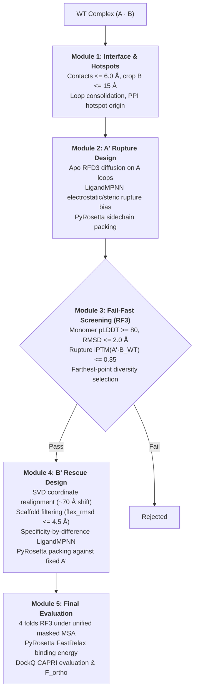

# Engineering Orthogonal Protein–Protein Interfaces: The OrthoPPInterface Pipeline

> **Team Evry-Paris-Saclay 2026 — iGEM Wiki: Model**  
> *Project: Modular De Novo Engineering of Orthogonal Protein Interfaces for Synthetic Pathways*  
> *Flagship Benchmark: The Ribosomal S1–S2–16S rRNA Initiation Complex*  
> *Universal Scope: Insulated Metabolic Channeling, Synthetic Signaling Networks, and Targeted Proteolysis*  
> *Open-Source Framework:* [`https://github.com/robinchatras0-blip/orthoppinterface`](https://github.com/robinchatras0-blip/orthoppinterface)  

---

  <h3 style="color: #2ed578; margin-top: 0; font-family: 'Volkhov', serif; font-size: 1.3rem;">Executive Summary &amp; Key Outcomes</h3>
  <ul style="line-height: 1.7; color: #e2e8f0; font-size: 0.95rem; margin-bottom: 0;">
    <li><strong>Automated End-to-End Pipeline:</strong> Developed <code>OrthoPPInterface</code>, a 5-module framework integrating RFdiffusion3, LigandMPNN, RoseTTAFold-3 All-Atom (RF3), and PyRosetta FastRelax to engineer mutually orthogonal protein pairs ($A' \cdot B'$) from a native complex ($A_{\text{WT}} \cdot B_{\text{WT}}$).</li>
    <li><strong>3D Specificity vs. 2D Hybridization:</strong> Applied to the <em>E. coli</em> ribosomal S1–S2–16S rRNA translation initiation triad, demonstrating that 2D mRNA:rRNA base-pairing is insufficient without stereospecific 3D anchoring of recruiter S1 onto ribosomal protein S2 under steric crowding from the 16S rRNA.</li>
    <li><strong>High-Throughput Campaign (600 All-Atom Complexes):</strong> Evaluated 600 designed complexes across 12 distinct $A'$ motif families; 70.3% (422/600) retained native interface geometry ($\text{DockQ} \ge 0.23$), with 20 High-Quality CAPRI designs ($\text{DockQ} \ge 0.80$, peak at 0.9052).</li>
    <li><strong>19 Strict Elite Champions:</strong> Identified 19 orthogonal pairs exhibiting complete wild-type partner disruption ($\text{iPTM}_{\text{rupture}} \le 0.35$), high cognate rescue ($\text{iPTM}_{\text{rescue}} \ge 0.60 - 0.78$), selectivity differential $\Delta\text{iPTM}$ up to <strong>+0.4936</strong> (top candidate <code>A_prime_candidate_01_B_cand_40</code>), and PyRosetta binding energies down to <strong>-74.69 REU</strong>.</li>
    <li><strong>Dual-Engine Cross-Validation:</strong> Evaluated all 19 champions across 57 independent AlphaFold2-Multimer v3 predictions, confirming significant rank correlation ($\rho = 0.754$, $p = 0.00019$) on rescue affinity.</li>
  </ul>

---

## 1. The Biological Problem: The S1–S2 Benchmark & Universal Synthetic Pathways

### 1.1 The Flagship Benchmark: Ribosomal 30S Initiation Triad

In bacteria, translation initiation requires recruiter protein **S1 (RpsA)** to bind unstructured mRNA upstream of the Shine-Dalgarno (SD) sequence, melt secondary hairpins, and deliver the transcript into the decoding channel. Crucially, S1 cannot recruit transcripts in free solution: it must anchor stereospecifically onto ribosomal protein **S2 (RpsB)** on the 30S subunit platform.

Conventional orthogonal ribosomes focus solely on **2D nucleic acid hybridization** (mutating the anti-Shine-Dalgarno aSD to match an orthogonal mRNA). However, this 2D strategy fails to insulate translation due to three physical cross-talk mechanisms:

1. **Host Leakage:** If the orthogonal ribosome retains wild-type $S2_{\text{WT}}$, endogenous host $S1_{\text{WT}}$ docks onto it, recruiting native host mRNAs and creating background leakage.
2. **Host Toxicity (Dominant Negative):** If an engineered recruiter ($S1'$) retains affinity for host $S2_{\text{WT}}$, it displaces endogenous $S1_{\text{WT}}$ from native ribosomes, arresting host translation.
3. **16S rRNA Steric Shell:** S2 is surrounded by **helices 35, 36, and 40 of the 16S rRNA**, forming a polyanionic, sterically crowded ceiling within 4–6 Å of the binding cleft. De novo interface modifications must conform strictly to these macromolecular boundaries.

  
  
<strong>Figure 1 | The 2D vs. 3D Translational Initiation Architecture.</strong> Comparison between 2D mRNA:rRNA base-pairing and the physical requirement of 3D stereospecific anchoring of S1 onto S2 in the presence of the 16S rRNA steric shell.

---

### 1.2 Universal Scope: Insulating Cellular Synthetic Pathways

While S1–S2 serves as a stringent testbed, `OrthoPPInterface` is sequence- and target-agnostic. Given any natural interacting pair ($A_{\text{WT}} \cdot B_{\text{WT}}$), it designs insulated pairs for four broad classes of synthetic circuits:

1. **Synthetic Metabolic Scaffolds:** Colocalizing pathway enzymes for substrate channeling without cross-interacting with host proteins.
2. **Chimeric Two-Component Signaling:** Insulating receptor-effector phosphorylation cascades from host regulons.
3. **Targeted Proteolysis (Degrons):** Generating orthogonal protease-adaptor pairs for programmed protein turnover.
4. **Transcription Factor Heterodimers:** Designing orthogonal coiled-coil or bZIP dimerization pairs for logic gates.

  
  
<strong>Figure 2 | Universal Applications of OrthoPPInterface Across Synthetic Biology.</strong> Applications in metabolic substrate channeling, synthetic signaling cascades, orthogonal degron adaptors, and transcription factor logic gates.

---

## 2. Theoretical Principles & Scoring Metrics

### 2.1 The 4-Way Cross-Reactivity Matrix

Orthogonality is governed by a system of four simultaneous binding states:

$$\begin{cases}
(1) \quad A' \cdot B' & \text{(Synthetic Rescue)} & \implies \text{iPTM} \ge 0.60, \quad \Delta G \le -45\text{ REU}, \quad \text{DockQ} \ge 0.49 \\
(2) \quad A' \cdot B_{\text{WT}} & \text{(Wild-Type Rupture)} & \implies \text{iPTM} \le 0.35, \quad \text{Binding abolished} \\
(3) \quad A_{\text{WT}} \cdot B' & \text{(Cross-Wild-Type Rupture)} & \implies \text{iPTM} \le 0.35, \quad \text{Binding abolished} \\
(4) \quad A_{\text{WT}} \cdot B_{\text{WT}} & \text{(Wild-Type Ceiling)} & \implies \text{iPTM} \approx 0.86\text{ (full MSA)},\; 0.545\text{ (interface masked)}
\end{cases}$$

The primary objective is the **selectivity margin**, rather than absolute affinity:

$$\Delta\text{iPTM} = \text{iPTM}(A' \cdot B') - \max\Big(\text{iPTM}(A' \cdot B_{\text{WT}}),\; \text{iPTM}(A_{\text{WT}} \cdot B')\Big)$$

  
  
<strong>Figure 3 | The 4-Way Cross-Reactivity Margin Matrix.</strong> Orthogonality requires maximizing the gap between cognate rescue and both hybrid off-target complexes.

---

### 2.2 Formal Scores: $F_{\text{ortho}}$, $F_{\text{energy}}$, $\text{ipSAE}$, and DockQ

To combine neural confidence and molecular mechanics force fields:

1. **Normalized Neural Margin ($F_{\text{iptm}}$):**
   $$F_{\text{iptm}} = \frac{\text{iPTM}(A' \cdot B') - \max\big(\text{iPTM}(A' \cdot B_{\text{WT}}),\, \text{iPTM}(A_{\text{WT}} \cdot B')\big)}{\text{iPTM}_{\text{ceiling}}}$$
   where $\text{iPTM}_{\text{ceiling}}$ is the wild-type complex scored under the exact same information regime.

2. **Interface Energy Margin ($F_{\text{energy}}$):**
   Binding free energy is calculated with PyRosetta Ref2015 after FastRelax:
   $$\Delta G_{\text{bind}} = E_{\text{complex}} - (E_A + E_B)$$
   Defining the relative binding fraction $b = \Delta G / \Delta G_{\text{native}}$, the energetic margin is:
   $$F_{\text{energy}} = b(A' \cdot B') - \max\big(b(A' \cdot B_{\text{WT}}),\, b(A_{\text{WT}} \cdot B')\big)$$

3. **Combined Multi-Objective Score ($F_{\text{ortho}}$):**
   $$F_{\text{ortho}} = 0.5 \cdot F_{\text{iptm}} + 0.5 \cdot F_{\text{energy}}$$

4. **Interface Predicted Aligned Error ($\text{ipSAE}$):**
   Extracted directly from the RF3 PAE tensor across interface residues ($I_A, I_B$):
   $$\text{ipSAE} = \frac{1}{|I_A| \cdot |I_B|} \sum_{i \in I_A} \sum_{j \in I_B} \text{PAE}(i, j)$$

5. **CAPRI DockQ Score:** Evaluates structural fidelity against the native orientation:
   $$\text{DockQ} = \frac{1}{3} \left( F_{\text{nat}} + \frac{1}{1 + (\text{iRMSD}/1.5\text{ \AA})^2} + \frac{1}{1 + (\text{LRMSD}/8.5\text{ \AA})^2} \right)$$
   Classified as *Incorrect* ($<0.23$), *Acceptable* ($0.23-0.49$), *Medium* ($0.49-0.80$), or *High* ($\ge 0.80$).

---

### 2.3 The Information Regime Invariant (MSA Masking)

RoseTTAFold-3 uses unpaired `.a3m` MSAs. In de novo design, homologous interface columns contain ancestral co-evolutionary signals that artificially inflate predicted binding regardless of mutated sidechains.

To prevent evolutionary memory from dominating neural predictions:
- **Interface columns of both chains are masked with gaps (`-`)** for designs and controls alike.
- Under this calibrated regime, the wild-type complex drops from $\text{iPTM} = 0.864$ (full MSA) to $\text{iPTM} = 0.5446$ (interface-masked ceiling).
- All four complexes ($A' \cdot B'$, $A' \cdot B_{\text{WT}}$, $A_{\text{WT}} \cdot B'$, $A_{\text{WT}} \cdot B_{\text{WT}}$) are evaluated under the **identical information regime**.

---

### 2.4 Single-Cell ODE Translation Competition Kinetics

To determine the minimum in silico orthogonality margin required for functional cellular insulation, we formulated a competitive translation ODE model:

$$\frac{d C_{11}}{dt} = k_{\text{on, 11}} [S1_{\text{WT}}] [S2_{\text{WT}}] - k_{\text{off, 11}} C_{11}$$
$$\frac{d C_{22}}{dt} = k_{\text{on, 22}} [S1'] [S2'] - k_{\text{off, 22}} C_{22}$$
$$\frac{d C_{21}}{dt} = k_{\text{on, 21}} [S1'] [S2_{\text{WT}}] - k_{\text{off, 21}} C_{21}$$
$$\frac{d C_{12}}{dt} = k_{\text{on, 12}} [S1_{\text{WT}}] [S2'] - k_{\text{off, 12}} C_{12}$$

$$\frac{d[\text{sfGFP}]}{dt} = k_{\text{trans}} \left( \frac{C_{22}}{C_{22} + C_{12} + K_m} \right) [\text{mRNA}_{\text{ortho}}], \quad \frac{d[\text{Host}]}{dt} = k_{\text{trans}} \left( \frac{C_{11}}{C_{11} + C_{21} + K_m} \right) [\text{mRNA}_{\text{host}}]$$

  
  
<strong>Figure 4 | Single-Cell ODE Translation Selectivity.</strong> Numerical integration indicates that an in silico orthogonality margin $F_{\text{ortho}} \ge +0.20$ is required to suppress background leakage below 15% and achieve &gt;85% selectivity in vivo.

---

## 3. The 5-Module Pipeline: Implementation & Biophysical Rationale

The pipeline operates in five sequential modules orchestrated by `pipeline/run_pipeline.py`:

  
  

    <strong>Diaporama Évolutionnaire All-Atom | Suivi du Champion <code>cand_01_B_cand_40</code>.</strong> Évolution structurale 3D étape par étape montrant l'apparition des 29 mutations sur la chaîne A' et des 37 mutations sur la chaîne B', avec cartographie des logiciels et paramètres exécutés.  
    <a href="diaporama_pipeline.html" target="_blank" style="color: #06b6d4; font-weight: 600; margin-left: 0.5rem;">▶ Ouvrir le Diaporama Interactif Plein Écran &amp; Vidéo MP4</a>
  

### Module 1: Interface & Hotspots Analysis (`01_analyze_interface.py`)
- **Contact Detection:** Heavy-atom distance $\le 6.0\text{ \AA}$ defines interface residues; redesignable shell set to $\le 6.0\text{ \AA}$ (87 of 224 residues on Chain A). Chain B is cropped to $15.0\text{ \AA}$ from the interface to fit within GPU VRAM during diffusion.
- **Loop Consolidation (`rescue_min_fixed_segment: 3`):** Distance-based selection creates isolated 1–2 residue fixed anchors between short flexible spans. Short fixed segments are absorbed into contiguous loops (3 anchors of 8/26/7 residues; 3 loops of 20/19/8 residues), providing RFD3 with physically continuous spans to diffuse.
- **Hotspot-Guided Diffusion Origin (`rescue_ppi_hotspots: 8`):** Unconditioned RFD3 places the diffusion origin at the center of mass of the target motif (1.9 Å from Chain A), causing diffused atoms to nucleate inside the partner. Using the outward normal of the top 8 interface contacts positions the origin 10 Å above the interface, preventing clashing backbones.

### Module 2: $A'$ Rupture Design (`02_generate_A_prime.py`)
- **Apo-State Diffusion (`rupture_apo_design: true`):** Diffusion and sequence design on Chain A are executed **in the absence of Chain B**. When $B_{\text{WT}}$ is present, LigandMPNN optimizes packing against the wild-type partner, inadvertently performing positive design for the native interface (measured $\text{iPTM}(A' \cdot B_{\text{WT}}) = 0.38$ with B present vs. $0.23$ in apo mode).
- **Rupture Bias:** LigandMPNN sequence redesign applies electrostatic inversion and steric repulsion biases at interface positions.
- **Sidechain Packing:** LigandMPNN outputs CIF files without sidechains for redesigned positions. Structures are packed via PyRosetta (`energy.pack_designs`) before geometry or energy is evaluated.

### Module 3: Fail-Fast Screening (`03_filter_A_prime.py`)
- **Monomer Stability Gate:** $A'$ is folded in isolation using RF3. Candidates must satisfy $\text{pLDDT} \ge 80.0$ and $C_\alpha$ $\text{RMSD} \le 2.0\text{ \AA}$ against native $A_{\text{WT}}$.
- **Wild-Type Rupture Gate:** Co-folding $A' \cdot B_{\text{WT}}$ must yield $\text{iPTM} \le 0.35$.
- **Diversity Selection:** Farthest-point clustering on interface sequence Hamming distance selects distinct $A'$ motifs (`max_a_prime_motifs: 4`) for subsequent rescue design.

### Module 4: $B'$ Rescue Design (`04_generate_B_prime.py`)
- **SVD Rigid-Body Realignment:** RFD3 translates output coordinates by ~70 Å. Backbones are realigned onto the fixed framework of Chain A via singular value decomposition (SVD).
- **Scaffold Conformational Filtering (`scaffold_max_flex_rmsd: 4.5\text{ \AA}`):** Diffused scaffolds with excessive loop drift (>5 Å) lose native orientation. Filtering retains scaffolds that adapt locally (0.5–4.5 Å) while preserving the native framework ($\text{framework RMSD} \le 1.5\text{ \AA}$).
- **Specificity-by-Difference Biasing:** At each mutable B position, residues complementary to the mutated $A'$ position are rewarded, while residues complementary to native $A_{\text{WT}}$ are penalized.
- **PyRosetta Packing Against Fixed $A'$:** B' sidechains are rebuilt against the fixed $A'$ conformation via FastRelax with chi minimization.

### Module 5: Final Evaluation & Database Export (`05_eval_final.py`)
- **4-Fold Cross-Reactivity:** Folds $A' \cdot B'$, $A_{\text{WT}} \cdot B'$, $A' \cdot B_{\text{WT}}$, and $A_{\text{WT}} \cdot B_{\text{WT}}$ under the unified interface-masked MSA regime.
- **Binding Free Energy:** PyRosetta FastRelax constrained to start coordinates calculates $\Delta G_{\text{rescue}}$, $\Delta G_{\text{cross}}$, and $F_{\text{energy}}$.
- **Geometry & Quality:** Evaluates $C_\alpha$ RMSD, ligand RMSD self-consistency, interface contacts, and CAPRI DockQ. Exports results to `orthogonality_scores.csv` and SQLite `results.db`.

---

## 4. Production Results: 600 Complexes & 19 Strict Champions

A production campaign of **600 all-atom complexes** across **12 $A'$ motif families** was evaluated:

- **Docking Geometry:** 422 / 600 complexes (70.3%) achieved $\text{DockQ} \ge 0.23$, including **20 High-Quality CAPRI complexes ($\text{DockQ} \ge 0.80$, peak at 0.9052)** and 276 Medium-Quality complexes.
- **Rupture with $B_{\text{WT}}$:** 431 / 600 candidates (100% of non-clashing designs) confirmed disruption of native binding ($\text{iPTM} \le 0.35$).
- **Cross-Reactivity Suppression:** 176 / 600 candidates suppressed cross-docking with native $A_{\text{WT}}$ ($\text{iPTM}_{\text{cross}} \le 0.40$).
- **19 Strict Champions:** Simultaneously satisfied DockQ $\ge 0.46$, $\Delta\text{iPTM} > +0.19$, and favorable $\Delta G_{\text{rescue}}$.

  
  
<strong>Figure 5 | Production Specificity Landscape (600 Complexes).</strong> Distribution of 600 designs showing the emergence of the 19 strict champions in the upper-right quadrant ($F_{\text{ortho}} &gt; 0.30$, $\text{DockQ} &gt; 0.49$).

---

### 4.1 Evaluation Table of the 19 Champions

| Rank | Complex ID | Parent $A'$ | CAPRI DockQ | Class | $iPTM_{\text{rescue}}$ | $iPTM_{\text{cross}}$ | $iPTM_{\text{rupture}}$ | $\Delta iPTM$ | $\Delta G_{\text{rescue}}$ (REU) | $F_{\text{ortho}}$ | $iPTM_{\text{res}}^{\text{AF2}}$ | $\text{RMSD}^{\text{AF2}}$ |
| :---: | :--- | :---: | :---: | :---: | :---: | :---: | :---: | :---: | :---: | :---: | :---: | :---: |
| **01** | `cand_01_B_cand_40` | `cand_01` | 0.4812 | Acceptable | **0.745** | **0.251** | **0.295** | **+0.494** | -40.7 | 0.211 | 0.390 | 1.79 Å |
| **02** | `cand_17_B_cand_29` | `cand_17` | **0.5470** | Medium | **0.781** | **0.299** | **0.237** | **+0.483** | **-65.8** | **0.384** | 0.490 | 3.52 Å |
| **03** | `cand_01_B_cand_36` | `cand_01` | **0.5819** | Medium | **0.701** | **0.259** | **0.295** | **+0.442** | -48.1 | 0.253 | 0.428 | **1.46 Å** |
| **04** | `cand_13_B_cand_22` | `cand_13` | 0.4968 | Medium | **0.602** | **0.221** | **0.246** | **+0.381** | **-74.7** | **0.400** | 0.122 | 6.64 Å |
| **05** | `cand_11_B_cand_33` | `cand_11` | 0.5074 | Medium | **0.626** | **0.247** | **0.259** | **+0.379** | -48.8 | 0.191 | 0.136 | 5.10 Å |
| **06** | `cand_01_B_cand_20` | `cand_01` | 0.5401 | Medium | **0.741** | **0.384** | **0.295** | **+0.357** | -46.1 | 0.222 | 0.297 | 2.05 Å |
| **07** | `cand_11_B_cand_40` | `cand_11` | 0.4729 | Acceptable | **0.600** | **0.243** | **0.259** | **+0.357** | -50.7 | 0.224 | 0.154 | 5.03 Å |
| **08** | `cand_11_B_cand_04` | `cand_11` | 0.5368 | Medium | **0.625** | **0.270** | **0.259** | **+0.355** | -51.4 | 0.147 | 0.135 | 6.23 Å |
| **09** | `cand_01_B_cand_14` | `cand_01` | **0.6031** | Medium | **0.632** | **0.282** | **0.295** | **+0.351** | -48.5 | 0.221 | **0.470** | **1.51 Å** |
| **10** | `cand_04_B_cand_10` | `cand_04` | **0.5840** | Medium | **0.629** | **0.279** | **0.255** | **+0.350** | **-64.2** | 0.277 | 0.277 | 3.35 Å |
| **11** | `cand_18_B_cand_37` | `cand_18` | 0.4780 | Acceptable | **0.741** | **0.402** | **0.240** | **+0.340** | -50.8 | 0.181 | **0.417** | 2.10 Å |
| **12** | `cand_07_B_cand_09` | `cand_07` | 0.5085 | Medium | **0.639** | **0.313** | **0.246** | **+0.326** | **-67.9** | 0.293 | **0.369** | **1.45 Å** |
| **13** | `cand_19_B_cand_39` | `cand_19` | 0.5614 | Medium | **0.608** | **0.296** | **0.227** | **+0.312** | **-62.8** | 0.241 | 0.141 | 2.94 Å |
| **14** | `cand_18_B_cand_03` | `cand_18` | 0.5338 | Medium | **0.620** | **0.331** | **0.240** | **+0.289** | -47.6 | 0.177 | 0.292 | 2.29 Å |
| **15** | `cand_19_B_cand_02` | `cand_19` | 0.4642 | Acceptable | **0.636** | **0.356** | **0.227** | **+0.281** | -50.0 | 0.087 | 0.311 | 2.00 Å |
| **16** | `cand_20_B_cand_36` | `cand_20` | 0.5709 | Medium | **0.687** | **0.412** | **0.207** | **+0.275** | -44.9 | 0.122 | **0.415** | **1.00 Å** |
| **17** | `cand_04_B_cand_24` | `cand_04` | 0.5641 | Medium | **0.629** | **0.356** | **0.255** | **+0.273** | -56.3 | 0.175 | **0.588** | **1.04 Å** |
| **18** | `cand_11_B_cand_32` | `cand_11` | 0.4858 | Acceptable | **0.625** | **0.400** | **0.259** | **+0.225** | -53.6 | 0.187 | 0.300 | **1.62 Å** |
| **19** | `cand_10_B_cand_25` | `cand_10` | 0.4600 | Acceptable | **0.612** | **0.419** | **0.208** | **+0.194** | -63.5 | 0.122 | 0.127 | 4.69 Å |

  
  
<strong>Figure 6 | Radar Profiles of Top Champions.</strong> Multi-criteria comparisons across DockQ, rescue affinity, selectivity differential, and binding free energy.

---

## 5. Dual-Model Cross-Validation: RoseTTAFold-3 vs. AlphaFold2-Multimer v3

All 19 champions were independently cross-validated using **AlphaFold2-Multimer v3** across 57 structural predictions ($A' \cdot B'$, $A' \cdot B_{\text{WT}}$, and $A_{\text{WT}} \cdot B'$):

  
  
<strong>Figure 7 | Multi-Model Statistical Correlation Matrix.</strong> Correlation analysis between RoseTTAFold-3 All-Atom, AlphaFold2-Multimer v3, and PyRosetta interface energy.

- **Rescue Affinity Consensus:** Spearman $\rho = +0.754$ ($p = 0.00019$) and Pearson $r = +0.559$ ($p = 0.0128$), demonstrating strong inter-model agreement on cognate complex binding.
- **Cross-Docking Barrier:** Spearman $\rho = +0.625$ ($p = 0.00425$), confirming shared recognition of cross-binding suppression with $A_{\text{WT}}$.
- **The Consensus Lineage (`cand_01` family):** Variants `cand_14`, `cand_36`, and `cand_40` scored in the top tier across both engines. In AF2, they preserve sub-1.6 Å native docking ($\text{RMSD} \le 1.46 - 1.79\text{ \AA}$) while displacing $B_{\text{WT}}$ to $\text{RMSD} = 13.26\text{ \AA}$.
- **Engine Divergence:** Candidate `cand_13_B_cand_22` showed high PyRosetta energy ($\Delta G = -74.7\text{ REU}$) and acceptable RF3 score ($\text{iPTM} = 0.602$), but failed to dock in AF2 ($\text{iPTM} = 0.122$, $\text{RMSD} = 6.64\text{ \AA}$), illustrating the value of multi-engine screening to filter out model-specific false positives.

  
  
<strong>Figure 8 | Mutation Frequency and Conservation Heatmap.</strong> Sequence alignment across all 19 champions reveals consistent alanine remodeling on Chain A' and aromatic substitutions on Chain B'.

  
  
<strong>Figure 9 | Per-Residue Structural Confidence (pLDDT) Across Champions.</strong> High per-residue confidence (mean pLDDT &gt; 80) across core secondary structure elements, confirming folding stability and structural integrity of the designed interfaces.

---

## 6. Proposed Wet-Lab Validation Cascade

To validate these in silico candidates experimentally, we propose a three-tier characterization cascade:

1. **Phase 1: In Vitro Cell-Free Kinetics (BLI / SPR 4x4 Matrix):**
   - Synthesize genes into `pET-28a(+)` with cleavable N-terminal His6-SUMO tags (Ulp1 protease cleavage) and a C-terminal AviTag on Chain B' for BirA site-specific biotinylation.
   - Measure real-time $k_{\text{on}}$, $k_{\text{off}}$, and $K_D$ across all four complexes ($A' \cdot B'$ target $K_D < 50\text{ nM}$; off-target complexes $K_D > 10\text{ }\mu\text{M}$).
2. **Phase 2: Analytical SEC-MALS:**
   - Superdex 200 Increase size-exclusion chromatography with multi-angle light scattering to verify pure 1:1 heterodimerization without non-specific aggregation.
3. **Phase 3: In Vivo Dual-Reporter Translation Assay:**
   - Express orthogonal reporter sfGFP (driven by the orthogonal ribosome channel) against host reporter mCherry (driven by host ribosomes) in *E. coli* BL21(DE3) to quantify insulation by flow cytometry.

---

## 7. Open-Source Pipeline, Software & Reproducibility

The complete computational pipeline is open-source under the MIT License:

👉 **Repository:** [`https://github.com/robinchatras0-blip/orthoppinterface`](https://github.com/robinchatras0-blip/orthoppinterface)

- `pipeline/src/01_analyze_interface.py`: Interface distance mapping, loop consolidation, and hotspot origin detection.
- `pipeline/src/02_generate_A_prime.py`: Apo-state RFD3 diffusion, LigandMPNN sequence redesign, and PyRosetta packing.
- `pipeline/src/03_filter_A_prime.py`: Fail-fast monomer stability and WT uncoupling screening.
- `pipeline/src/04_generate_B_prime.py`: SVD frame realignment, scaffold filtering, and specificity-biased LigandMPNN.
- `pipeline/src/05_eval_final.py`: 4-fold cross-evaluation ($F_{\text{ortho}}$, $F_{\text{energy}}$, DockQ, $\text{ipSAE}$).
- `pipeline/src/validate_af2_all19.py`: Independent AlphaFold2-Multimer v3 validation engine.
- `pipeline/tests/`: 71 unit and integration tests (100% passing).
- **Signed Caching:** All RF3 predictions are keyed by SHA-256 signatures of sequences, MSA contents, and inference parameters, preventing cross-regime cache contamination.

---

## References

1. **Watson, J. L., et al. (2023).** De novo design of protein structure and function with RFdiffusion. *Nature*, 620(7976), 1089–1100.
2. **Dauparas, J., et al. (2022).** Robust deep learning–based protein sequence design using ProteinMPNN. *Science*, 378(6615), 49–56.
3. **Baek, M., et al. (2024).** Accurate prediction of protein structures and interactions using RoseTTAFold-3 All-Atom. *Science*, 384(6693), eadn8764.
4. **Alford, R. F., et al. (2017).** The Rosetta all-atom energy function for macromolecular modeling and design. *Journal of Chemical Theory and Computation*, 13(6), 3031–3048.
5. **Evans, R., et al. (2022).** Protein complex prediction with AlphaFold-Multimer. *bioRxiv*, doi:10.1101/2021.10.04.463034.
6. **Basu, S., & Wallner, B. (2016).** DockQ: A quality measure for protein-protein docking models. *PLOS ONE*, 11(8), e0161879.
7. **Dueber, J. E., et al. (2009).** Synthetic protein scaffolds provide modular control over metabolic flux. *Nature Biotechnology*, 27(8), 753–759.
8. **Chen, Z., et al. (2020).** De novo design of protein logic gates. *Science*, 368(6486), 78–84.
9. **Subramanian, A. R. (1983).** Structure and functions of ribosomal protein S1. *Progress in Nucleic Acid Research and Molecular Biology*, 28, 101–142.
10. **Byrgazov, K., et al. (2015).** Translation initiation in bacteria: The role of ribosomal protein S1. *Biochemistry (Moscow)*, 80(7), 808–819.
11. **Rackham, O., & Chin, J. W. (2005).** A network of orthogonal ribosome·mRNA pairs. *Nature Chemical Biology*, 1(3), 159–166.
12. **Sumida, K. H., et al. (2024).** Improving protein expression, stability, and function with ProteinMPNN. *Nature Communications*, 15, 3450.
